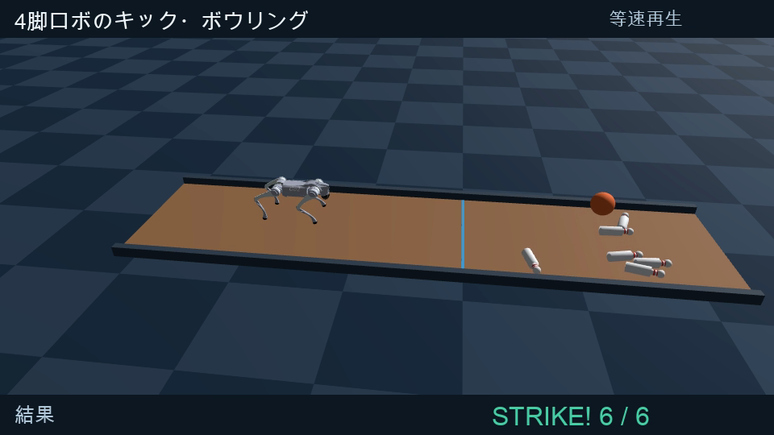

# 4脚ロボットのキック・ボウリング

Unitree Go2が、学習済みの歩行で球へ近づき、停止・体重移動をして右前足で蹴り、6本のピンを倒す課題です。

**確認結果：完成版の撮影で6/6本。終了時まで立位を維持。**
これは固定条件での再現確認であり、異なる球位置に対する成功率を示すものではありません。

[実演動画（1分32秒）](output/video/PAI最終課題_60587.mp4) · [説明資料](output/pdf/説明資料_PAI最終課題_60587.pdf)



## まず動かす

動作確認環境はApple Silicon Mac、Python 3.12、Metal/MPSです。ffmpegとffprobeも使用します。

```bash
uv venv --python 3.12 .venv
uv pip install --python .venv/bin/python -r requirements.txt
.venv/bin/python kick_bowling.py --name demo --aim-y 0 --swing-time 0.16 --fps 50 --recovery-model recovery --handover 1.5
```

学習済み方策を同梱しているので、再学習は不要です。`videos/kick_demo.mp4`と状態記録のJSONが生成されます。
初回は物理計算カーネルのコンパイルに時間がかかります。

全景を固定して見る場合：

```bash
.venv/bin/python kick_bowling.py --name demo_wide --aim-y 0 --swing-time 0.16 --fps 50 --wide --recovery-model recovery --handover 1.5
```

横からの固定視点で撮る場合：

```bash
.venv/bin/python kick_bowling.py --name demo_side --aim-y 0 --swing-time 0.16 --fps 50 --side --recovery-model recovery --handover 1.5
```

## AIと制御の分担

1. **接近・停止：PPOで学習したActor**
   既知の球位置から速度指令を作り、姿勢・関節状態・速度指令など45値をActorへ入力します。Actorは12関節の目標角度の補正量を出力します。
2. **体重移動とキック：解析的IK**
   胴体目標と足先の世界座標軌道から脚の関節角度を計算します。先に左・後方へ体重を移し、3脚で支持してから右前足を振ります。キック自体はPPOで直接学習した動作ではありません。
3. **関節駆動：PD制御**
   関節目標へ追従させます。球とピンはGenesisの接触・摩擦・重力で動きます。投球中に球やピンの位置・速度を書き換えて倒す処理はありません。

4. **キック後の立位維持：追加学習したPPO Actor**
   蹴った足が戻る時点で復帰用Actorへ滑らかに切り替え、胴体の傾きと動きを抑えます。

Go2のURDFはGenesis同梱の原本を使用します。

## 学習の流れ

Actor/Criticは512→256→128のMLP（ELU）。1024並列環境×24ステップ/反復、PPO 5 epoch・4 minibatchです。
採用した方策は基本歩行100反復、ランダムな横方向外力を加えて150反復、可変速度・停止・旋回を含めて500反復の計750反復から得ています。復帰用Actorは、この方策から別途350反復を追加学習して採用しました。

```bash
.venv/bin/python train.py --run baseline_01 --iterations 100 --num-envs 1024 --video-every 25
.venv/bin/python train.py --run robust_01 --iterations 150 --num-envs 1024 --video-every 50 --resume logs/baseline_01/checkpoint_0100.pt --push-max 100
.venv/bin/python train.py --run locomotion_01 --iterations 500 --num-envs 1024 --video-every 100 --resume logs/robust_01/checkpoint_0250.pt --push-max 40 --variable-commands
```

既存runは上書きせず終了します。別名を指定してください。再学習は実装・バージョン・乱数状態によって結果が変わり得ます。提出動画の再生成には同梱方策を使用してください。

## タスクの条件と判定

- 球：質量1.0 kg、半径0.12 m。初期位置x=0.85 m、y=0 m。
- ピン：6本、各0.10 kg、全高約0.315 m、3列の三角形配置。
- レーン：5.6×1.4 m、側面バンパー付きのミニレーン。
- 得点：鉛直から45度を超えて傾いたピンの数。終了時にも全6本が倒れていることを確認。
- 立位：姿勢記録と映像を確認。最大傾き7.40度（改善前20.44度）、終了時0.28度。`results/recovery_selection.json` に記録。
- 球の最大前進速度：約1.70 m/s。

足先の目標ストロークは約0.335 m、振り出し時間0.16秒です。
球・ピン位置はシミュレータの既知座標を使用し、画像認識は行っていません。キック軌道は固定条件向けです。

## 動画とレポートの再生成

```bash
.venv/bin/python edit_bowling.py
.venv/bin/python make_report.py
```

`edit_bowling.py`は同梱の撮影素材を編集し、日本語説明音声をmacOSのKyoko音声で生成します。
動画は歩行学習前・歩行のみ・キック試作・追加学習後の完成の4段階を同じ配置・全景カメラで比較し、完成版の横視点リプレイ → 全景の結果確認の順に構成します。横視点リプレイだけ1/4倍速と画面に明記し、それ以外は等速です。

提出用ファイル：

- `output/video/PAI最終課題_60587.mp4`
- `output/video/PAI最終課題_60587.srt`
- `output/pdf/説明資料_PAI最終課題_60587.pdf`

## 主なファイル

- `kick_bowling.py`：接近・停止・体重移動・前足キック・得点判定・録画
- `environment.py`：Go2、レーン、球、ピンを含むGenesis環境
- `assets/bowling_pin.urdf`：作成したピンの形状・質量・衝突モデル
- `models/locomotion.pt`：学習済みActorのTorchScript
- `models/locomotion_training_config.json`：採用方策の学習条件
- `models/checkpoints/locomotion_0750.pt`：最終学習チェックポイント
- `models/manifest.json`：モデルと制御手法の説明
- `train.py`：PPO学習と途中動画の保存
- `videos/kick_stable_side.*`・`videos/kick_stable_wide.*`：姿勢改善後の提出用撮影素材と状態記録

参照元と変更点は`THIRD_PARTY.md`を参照してください。

## 学習前との比較

`models/untrained.pt`は更新0回の方策です。配置・カメラ・制御手順をそろえ、方策だけを切り替えます。6秒以内に接近できない場合はキックへ移りません。学習しているのは歩行・停止で、キック軌道はIK・PDで設計しています。完成版では、蹴った後の立位維持にも追加学習した方策を使います。

```bash
.venv/bin/python kick_bowling.py --name untrained_comparison --model untrained --aim-y 0 --swing-time 0.16 --fps 50 --wide
```

撮影結果：学習前は球へ到達できず0/6本、学習後は接近・停止して6/6本。

## 4段階比較の再生成

②〜④は同じ750反復の歩行方策です。②はキックを省略、③は支持改良前の前足キック、④は体重移動・3脚支持に加え、学習した立位復帰を使う完成制御です。4つの学習チェックポイントではありません。

```bash
.venv/bin/python kick_bowling.py --name walk_only --stage walk-only --aim-y 0 --swing-time 0.16 --fps 50 --wide
.venv/bin/python kick_bowling.py --name unstable --stage unstable --aim-y 0 --swing-time 0.16 --fps 50 --wide
```

## キック後の姿勢維持の追加学習

歩行用Actorはそのまま使用し、別のActorを750反復の歩行方策からPPOで追加学習しました。
旧キックの復帰区間から採取した胴体姿勢・関節角を初期状態にし（速度は0）、停止指令の下で水平姿勢、胴体高さ、低い角速度、滑らかな関節制御を報酬にします。512並列環境、24ステップ/反復、6秒エピソードです。

最初の150反復後に姿勢のペナルティを強めて継続し、途中モデルを実際の投球で評価します。採用したのは150+200=350反復のモデルです（計450反復まで学習）。採用した反復数と測定値は `results/recovery_selection.json` に記録します。キック開始1.5秒後から0.3秒かけて姿勢維持Actorへ切り替えます。大きな揺れの低減には、この切り替えの改善も寄与しています。

```bash
.venv/bin/python kick_bowling.py --name recovery_baseline --aim-y 0 --swing-time 0.16 --fps 25 --wide --save-states
.venv/bin/python train_recovery.py --run recovery_01 --iterations 150 --num-envs 512 --checkpoint-every 50
.venv/bin/python train_recovery.py --run recovery_balance_02 --iterations 300 --num-envs 512 --checkpoint-every 100 --resume logs/recovery_01/checkpoint_0150.pt --export-prefix recovery_balance --orientation-penalty 40
```

完成版の再撮影は次のコマンドを使います。全景と横視点を同じ物理シミュレーションから同時に保存します。

```bash
.venv/bin/python kick_bowling.py --name stable_wide --aim-y 0 --swing-time 0.16 --fps 50 --wide --dual-view --recovery-model recovery --handover 1.5
```

途中動画は `videos/kick_recovery_*.mp4` に保存。公開用パッケージには完成版と比較用素材を同梱しています。6本成功は固定条件の実演結果であり、異なる条件に対する成功率ではありません。

比較用の最初の3段階をまとめて再撮影する場合は `python record_comparison.py` を実行します。
